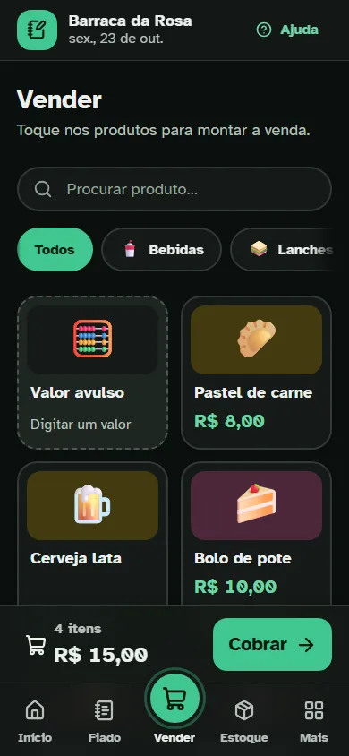
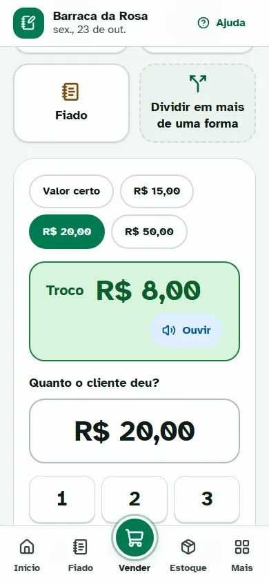
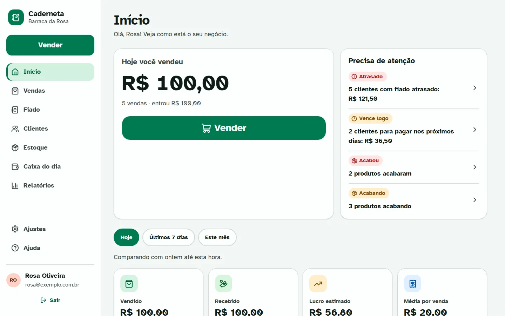
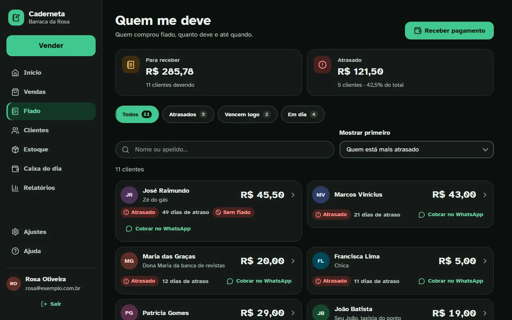

# Caderneta: protótipo de gestão comercial

> Suas vendas, o fiado e o estoque na palma da mão.

Protótipo **front-end de alta fidelidade** de um SaaS de gestão comercial para **pequenos negócios e vendedores ambulantes**. É a base definitiva da interface do produto real: tudo é navegável e interativo, mas **não há back-end nem persistência**. Os dados de exemplo vivem em memória e voltam ao estado inicial quando a página é recarregada.

"Caderneta" é um nome provisório, que lembra o caderninho do fiado. Para trocar, edite `src/app/config.js` e o `<title>` de `index.html`.

## Para quem é

Para quem vende na rua, na feira, na barraca, no carrinho ou numa lojinha, e precisa controlar o dinheiro **sem complicação**. A interface foi pensada para quem tem **pouca familiaridade com tecnologia**:

- botões grandes, sempre com ícone **e** texto;
- palavras do dia a dia ("Quem me deve", "Troco", "Mercadoria acabando");
- teclado numérico próprio, parecido com uma calculadora;
- botão "Desfazer" em vez de perguntas confusas;
- leitura em voz alta, tamanho de letra ajustável, tema escuro e de alto contraste.

## Funcionalidades

| Área                   | O que faz                                                                                                                                                      |
| ---------------------- | -------------------------------------------------------------------------------------------------------------------------------------------------------------- |
| **Vender**             | Venda por produto (toque no card) ou por valor avulso; desconto; carrinho sempre visível; baixa automática do estoque                                          |
| **Receber**            | Dinheiro (com troco em destaque), Pix (QR da chave do negócio), débito, crédito (à vista ou parcelado), **fiado** e **pagamento dividido** entre várias formas |
| **Fiado**              | "Quem me deve" ordenado por urgência; vencimentos; limite de crédito por cliente; bloqueio; pagamentos parciais; cobrança pronta pelo WhatsApp                 |
| **Estoque**            | Produtos com emoji/foto, custo, preço e margem; entradas, ajustes e perdas; alertas de "acabando" e "acabou"                                                   |
| **Caixa do dia**       | Troco inicial, entradas por forma de pagamento, despesas, conferência no fechamento                                                                            |
| **Início (dashboard)** | Quanto vendeu hoje, lucro estimado, a receber, gráficos da semana, formas de pagamento, avisos importantes                                                     |
| **Relatórios**         | Por período e por tipo; exportação em Excel (CSV), PDF (impressão) e compartilhamento                                                                          |
| **Ajustes**            | Dados do negócio, chave Pix, taxas da maquininha, regras de estoque, acessibilidade, modo demonstração                                                         |

> O protótipo está completo: as 12 fases do [Roadmap](#roadmap) foram concluídas, da fundação ao polimento final (estados de carregando, vazio e erro em todas as telas, animações, auditoria de acessibilidade com o axe, "instalar na tela inicial" e o teste do fluxo principal de ponta a ponta). O catálogo vivo de componentes fica em `/design-system`.

## Como rodar

Pré-requisito: **Node.js 22 ou superior**.

```bash
npm install
npm run dev
```

Acesse `http://localhost:5173` e toque em **"Entrar com conta de demonstração"** para ver o app com os dados de exemplo da "Barraca da Rosa". Qualquer e-mail e senha também entram, e **"Criar conta"** mostra as boas-vindas, com a opção de começar do zero. Como nada é salvo, recarregar a página sai da conta e volta aos dados de exemplo.

### Scripts

| Comando                                   | Descrição                                                                         |
| ----------------------------------------- | --------------------------------------------------------------------------------- |
| `npm run dev`                             | Servidor de desenvolvimento                                                       |
| `npm run build`                           | Build de produção (`dist/`)                                                       |
| `npm run preview`                         | Serve o build localmente                                                          |
| `npm test` / `npm run test:watch`         | Testes com Vitest + Testing Library                                               |
| `npm run lint`                            | ESLint (React, Hooks, acessibilidade JSX)                                         |
| `npm run format` / `npm run format:check` | Prettier                                                                          |
| `npm run shot -- <arquivo.png> [rota]`    | Captura de tela headless para verificação visual (veja `scripts/screenshot.mjs`)  |
| `npm run a11y`                            | Auditoria de acessibilidade com o axe em todas as telas (veja `scripts/a11y.mjs`) |
| `npm run icons`                           | Gera os ícones do app (PWA) a partir do `public/favicon.svg`                      |

## Tecnologias

- **React 19** em JavaScript (JSX), com contratos de dados documentados em **JSDoc**
- **Vite 8** para build e dev server
- **React Router 8** para as rotas
- **CSS puro e moderno**: `@layer`, custom properties, `oklch()`, `color-mix()`, `light-dark()`, nesting nativo, `:has()`, container queries, `@starting-style`, View Transitions, `scroll-snap`, `@property`, `@media print`. **Sem Tailwind.**
- **Recharts** para os gráficos, colorido pelos tokens do design system
- **lucide-react** para os ícones, **Atkinson Hyperlegible** como fonte (feita para máxima legibilidade)
- **Vitest**, **Testing Library**, **ESLint** (com `jsx-a11y`) e **Prettier**

## Estrutura do projeto

```
src/
├─ app/          configuração, rotas e providers
├─ styles/       CSS global em camadas (reset, tokens, base, utilitários, impressão)
├─ components/   ui/ (design system), layout/, charts/
├─ features/     uma pasta por área (sales, fiado, inventory, cash, reports...)
├─ domain/       modelos (JSDoc), constantes e regras de negócio puras
├─ mocks/        dados de exemplo e banco em memória
├─ services/     camada de acesso a dados (o ponto de troca pela API real)
├─ store/        estado global (Context + useReducer)
├─ hooks/        hooks reutilizáveis
└─ lib/          formatação, CSV, WhatsApp, compartilhamento
docs/            plano de implementação, regras de negócio e design system
scripts/         capturas de tela (shot), auditoria de acessibilidade (a11y) e ícones do app
public/          favicon, ícones e manifest ("instalar na tela inicial")
```

Os detalhes e as convenções estão no [`CLAUDE.md`](./CLAUDE.md).

## Decisões técnicas

- **Front-end only, estado em memória.** O protótipo demonstra todos os fluxos sem depender de servidor. Recarregar restaura os dados de exemplo, e há também o botão "Restaurar dados de exemplo" em Ajustes.
- **Dinheiro em centavos inteiros.** Evita erros de arredondamento (R$ 0,10 + R$ 0,20 dá exatamente R$ 0,30).
- **Regras de negócio isoladas e testadas** em `src/domain/rules`, independentes de React.
- **Camada de serviços assíncrona com latência simulada.** As telas já nascem com estados reais de carregamento e erro, e o modo demonstração permite simular lentidão e falhas.
- **Dados de exemplo determinísticos e relativos a hoje.** Os dashboards sempre mostram um negócio "vivo".

## Integração futura com o back-end

O protótipo foi organizado para que a troca por uma API real seja localizada:

1. **Contratos**: `src/domain/models.js` descreve todas as entidades (Produto, Venda, Pagamento, Cliente, ContaFiado, MovimentoEstoque, Despesa, Caixa, Negócio) e `docs/regras-de-negocio.md` descreve as regras que o back-end deve **revalidar**.
2. **Serviços**: cada função de `src/services/*.service.js` já é `async` e tem assinatura equivalente a um endpoint REST. Basta trocar a implementação em memória por chamadas HTTP, mantendo a mesma assinatura.
3. **Mocks**: `src/mocks/` pode ser removido ou reaproveitado em testes e em MSW.
4. **Regras puras**: `src/domain/rules` pode continuar no front para feedback imediato (troco, totais, status) e ser espelhado no servidor.
5. **Rede**: `request` (`src/services/api.js`) é o único lugar que simula latência e falha; ele vira o `fetch` (com o token da sessão), e os `ApiError` com os códigos de `ERROR_MESSAGES` continuam chegando às telas, que já mostram carregando, erro e "Tentar de novo".

Próximos passos sugeridos para o produto real, nesta ordem: trocar `services/` pela API (começando por `auth.service.js`, depois vendas, fiado, estoque e caixa); trocar o `fetchAllData` do `DataProvider` por cargas por tela e paginadas quando o volume crescer; guardar a sessão de forma segura; decidir o funcionamento sem internet (fila de vendas e service worker); e manter `npm test`, `npm run a11y` e o teste do fluxo principal (`src/mainFlow.test.jsx`) numa etapa de CI.

## Roadmap

**Fases 1 a 12 concluídas.** O detalhamento de cada fase está em [`docs/plano-de-implementacao.md`](./docs/plano-de-implementacao.md).

| Fase | Entrega                                                              | Status       |
| ---- | -------------------------------------------------------------------- | ------------ |
| 1    | Fundação: Vite, React, ESLint, Prettier, Vitest, fonte, documentação | ✅ Concluída |
| 2    | Design system: tokens, componentes `ui/`, página `/design-system`    | ✅ Concluída |
| 3    | Domínio e dados: modelos, regras + testes, seed, serviços, store     | ✅ Concluída |
| 4    | Shell e navegação: layout, rotas, login simulado, boas-vindas        | ✅ Concluída |
| 5    | Vender: PDV, carrinho, pagamentos, venda concluída, histórico        | ✅ Concluída |
| 6    | Fiado e clientes: quem me deve, receber, cobrar no WhatsApp, CRUD    | ✅ Concluída |
| 7    | Estoque: lista, produto com prévia e margem, entrada, ajuste, perda  | ✅ Concluída |
| 8    | Caixa e despesas: abrir, entradas, despesas, fechar e reabrir o dia  | ✅ Concluída |
| 9    | Dashboard: hoje, avisos, indicadores, gráficos e atalhos             | ✅ Concluída |
| 10   | Relatórios: filtros, prévia, Excel (CSV), PDF e compartilhar         | ✅ Concluída |
| 11   | Ajustes, acessibilidade, ajuda e tour                                | ✅ Concluída |
| 12   | Polimento, auditoria de acessibilidade, PWA básico                   | ✅ Concluída |

## Limitações do protótipo

- Nenhum dado é salvo: recarregar a página volta aos dados de exemplo.
- Login, Pix, maquininha e WhatsApp são simulados: o Pix mostra um QR da chave configurada e o WhatsApp abre um link `wa.me` com a mensagem pronta.
- Não há multiusuário, sincronização ou emissão fiscal.
- Dá para "instalar na tela inicial" (manifest e ícones), mas o app não funciona sem internet: não há service worker, de propósito, porque nada é guardado.

## Capturas de tela

No celular: o Início, a venda montada (tema escuro) e o troco em destaque.

<p>
  
  
  
</p>

No computador: o Início e o fiado (tema escuro).





As imagens ficam em `docs/capturas/` e são feitas com `npm run shot` (nome terminado em `.webp`).
